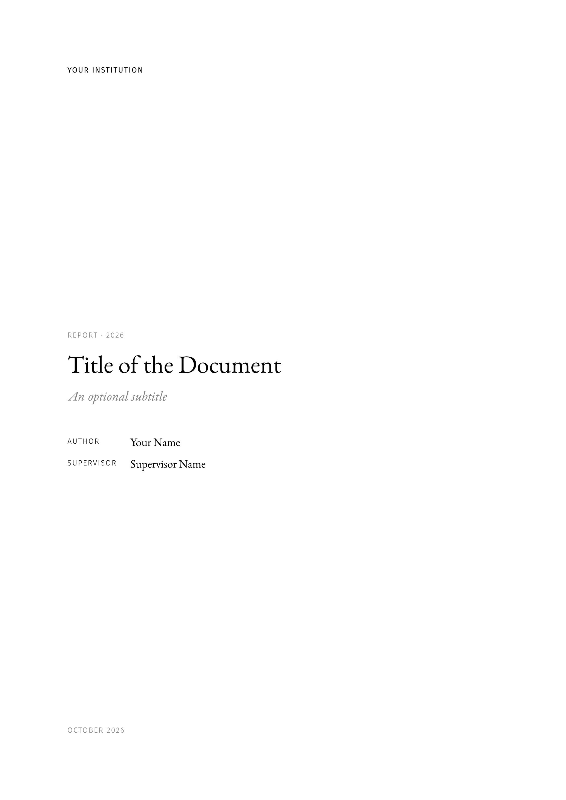

# quire

A classical Typst template for books, reports and articles: EB Garamond text with small caps, quiet sans-serif
labels, thin golden rules and generous margins, ready for print and for screens.



A _quire_ is a gathering of folded sheets, the unit books are sewn from.

## Features

- **Three structures**, chosen with `top-level`: documents divided in parts (`"part"`), chapters (`"chapter"`) or
  only sections (`"section"`, for articles).
- **Print and digital output**: recto openings with clean blank pages, a wider inner margin and link footnotes for
  print; symmetric margins and colored links for screens.
- **Front matter**: title page, dedication and colophon, acknowledgments, abstracts in several languages and table of
  contents, or a title block for articles.
- **Localized** in English, Spanish and Catalan.
- **Customizable** fonts and colors.
- Theorem-like environments (with [theorion](https://typst.app/universe/package/theorion)), code listings (with
  [codly](https://typst.app/universe/package/codly)), appendices, and figures and equations numbered within
  sections.

## Usage

```sh
typst init @preview/quire
```

or, in an existing document:

```typ
#import "@preview/quire:0.1.0": *

#show: quire.with(
  title: [On Bookbinding],
  authors: "Jane Doe",
  lang: "en",
  top-level: "chapter",
  output: "print",
)

= Introduction
```

See the [manual](docs/manual.pdf) for every option, and [`examples/`](examples) for an article and a book.

### Fonts

The default style requires these fonts, which are not bundled with the package:
[EB Garamond](https://github.com/octaviopardo/EBGaramond12) (the `EB Garamond 12` and `EB Garamond 08` families),
[Fira Sans](https://github.com/mozilla/Fira), [Garamond-Math](https://github.com/YuanshengZhao/Garamond-Math) and
[JuliaMono](https://github.com/cormullion/juliamono). Any of them can be replaced:

```typ
#show: quire.with(
  fonts: (serif: "Libertinus Serif", math: "Libertinus Math"),
  colors: (link: rgb("#7a1f3d")),
  strong: "bold",
)
```

### Dates

Dates given as `datetime` are shown with English month names, since Typst does not localize dates yet
([typst/typst#2840](https://github.com/typst/typst/issues/2840)). Pass the date as content to localize it, e.g.
`date: [junio de 2026]`.

## Development

The development environment is managed with [devenv](https://devenv.sh). Enter it with `devenv shell`, which also
installs the git hooks (Conventional Commits, typstyle, markdownlint, alejandra), and run `just` to list the recipes:

- `just build` compiles the manual, the examples and the template, and renders the thumbnail.
- `just watch <file>` recompiles a file on changes.
- `just format` formats the Typst sources; `just check` runs every hook on every file.

The template and the examples import `@preview/quire`; the recipes expose the working tree under that name through
`build/packages`.

## License

The package is distributed under the [MIT license](LICENSE). The citation style `src/assets/quire.csl` is a
derivative of the [IEEE CSL style](https://www.zotero.org/styles/ieee), distributed under
[CC BY-SA 3.0](https://creativecommons.org/licenses/by-sa/3.0/).
